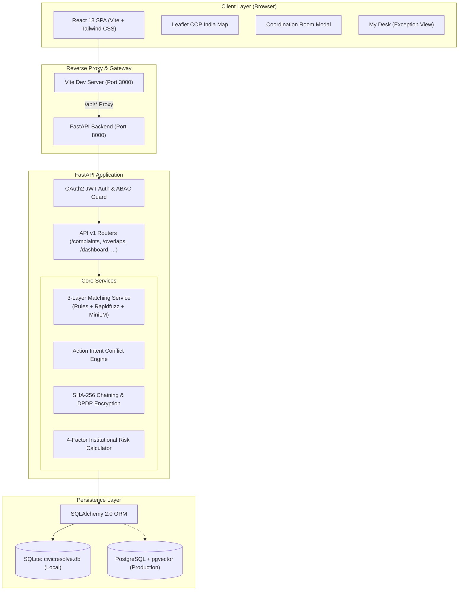

# System Architecture Document – Samanvay (समन्वय)

This document describes the high-level architecture, module breakdown, data flows, and technology stack for Project Samanvay.

---

## 1. High-Level System Architecture



---

## 2. Technology Stack

| Layer | Technology | Version | Purpose |
| :--- | :--- | :--- | :--- |
| **Frontend Framework** | React + TypeScript | 18.2 / TS 5.2 | Component-driven single-page application. |
| **Build Tool & Bundler** | Vite | 5.0 | High-performance build tool with instant HMR and `/api` proxy. |
| **Styling & UI** | Tailwind CSS + Radix UI | 3.4 / Radix 2.0 | Clean, accessible government-grade design system. |
| **Mapping & Charts** | Leaflet + Recharts | 1.9 / 2.10 | National institutional geo-map and analytics dashboards. |
| **Backend Framework** | FastAPI (Python) | 0.109 | High-speed async RESTful API engine. |
| **ASGI Web Server** | Uvicorn | 0.27 | ASGI server with live auto-reload for local development. |
| **Data Modeling / ORM** | SQLAlchemy | 2.0 | Advanced relational ORM supporting SQLite and PostgreSQL. |
| **Text Matching / NLP** | `rapidfuzz` + `sentence-transformers` | 3.6 / 2.2 | Token-ratio fuzzy matching and `all-MiniLM-L6-v2` embeddings. |
| **Security & DPDP** | `cryptography` (Fernet) + `bcrypt` | 42.0 / 4.0 | AES-GCM PII field encryption, hash chaining, and password hashing. |
| **Database** | SQLite / PostgreSQL | 3 / 14+ | Zero-config embedded SQLite for dev; PostgreSQL for production. |

---

## 3. Directory & Module Structure

```
d:\sih\
├── backend\
│   ├── app\
│   │   ├── main.py                   # FastAPI initialization, CORS, global error handling
│   │   ├── core\
│   │   │   ├── config.py             # Settings (JWT secret, expiration, database URL)
│   │   │   ├── database.py           # Engine, SessionLocal, SQLite UUID dialect compiler
│   │   │   ├── migrations.py         # Lightweight auto-migrations for SQLite
│   │   │   └── security.py           # Bcrypt hashing, DPDP field encryption, JWT generation
│   │   ├── models\                   # 16 Domain models (Complaints, Overlaps, AuditLog, etc.)
│   │   ├── api\v1\endpoints\         # 11 RESTful route modules
│   │   └── services\
│   │       └── matching_service.py   # Multi-tier duplicate & overlap detection pipeline
│   └── tests\                        # 36 Automated integration tests with isolated test SQLite DB
│
├── frontend\
│   └── src\
│       ├── main.tsx                  # App bootloader with React Query & React Router
│       ├── App.tsx                   # Top-level routing and authentication guards
│       ├── context\                  # AuthContext (JWT/roles) & LanguageContext (EN/HI)
│       ├── layouts\                  # Layout.tsx (Sidebar navigation, header, notification badge)
│       ├── components\               # CopMap, CoordinationRoomModal, DailyBriefingModal, RiskScoreModal
│       └── pages\                    # 12 functional views (Dashboard, Complaints, Overlaps, AuditLogs, etc.)
│
└── scripts\                          # Seeding, verification flows, benchmark evaluation harnesses
```

---

## 4. End-to-End Data Flows

### A. Case Intake & Proactive Overlap Detection
1. **Input**: Case Officer types college name into [Complaints.tsx](file:///d:/sih/frontend/src/pages/Complaints.tsx).
2. **Debounce (300ms)**: Calls `GET /api/institutions/lookup?q=...` $\rightarrow$ fuzzy matches across official names and alternate acronyms.
3. **Pre-Check Query**: Calls `POST /api/complaints/pre-check-overlap` passing `institution_id` and selected category.
4. **Resolution**: If an active complaint exists in another bureau, the backend returns candidate details. Frontend renders the **Pre-Save Overlap Warning Card**.
5. **Intake Completion**: Officer selects either standard submission or *"Save & Open Coordination Room"*.

### B. Coordination Room & Joint Decision Flow
```mermaid
sequenceDiagram
    autonumber
    actor Sharma as RB Officer (Sharma)
    actor Verma as PGRC Officer (Verma)
    participant API as Samanvay API
    participant DB as Database & Audit Ledger

    Sharma->>API: Open Coordination Room (Case 1 & Case 2)
    API->>DB: Fetch both case records & compare diffs
    API-->>Sharma: Return side-by-side diff + Playbook Lead (Regulation Bureau)
    Sharma->>API: Propose Regulation Bureau as Lead
    API->>Verma: Send high-priority coordination alert
    Verma->>API: Accept Lead Proposal
    Verma->>API: Post Action Intent: "Hearing on Nov 15"
    Sharma->>API: Post Action Intent: "Inspection on Nov 16"
    API-->>Sharma: ⚠️ WARNING: Hearing scheduled Nov 15. Inspection on Nov 16 may prejudice hearing!
    Sharma->>API: Adjust inspection date to Nov 22 (Conflict Resolved)
    Sharma->>API: Click "Record Joint Decision" (RB leads; Joint hearing Nov 15; Inspection Nov 22)
    API->>DB: Write SHA-256 hash-chained decision to BOTH case timelines
    DB-->>API: Cryptographic block confirmed
    API-->>Sharma: Coordination complete & joint order published
    API-->>Verma: Coordination complete & joint order published
```

---

## 5. Security & Isolation Architecture

1. **Dual-Layer Database Abstraction**:
   - Built to run seamlessly on SQLite during development with zero native dependencies.
   - Dialect compilation hook `@compiles(UUID, "sqlite")` converts PostgreSQL UUID types into `CHAR(36)` on SQLite, enabling identical schema definition across dev and prod.
2. **Cryptographic DPDP Compliance**:
   - Personal Data fields (`complainant_name`, `complainant_phone`, `complainant_email`) are symmetrically encrypted using Fernet (AES-GCM).
   - Only authorized officers within the assigned bureau hold the key to decrypt complainant details in the UI.
3. **Tamper-Evident SHA-256 Hash Chaining**:
   - The `AuditLog` and `CaseAction` tables maintain a continuous cryptographic hash chain:
     $$\text{Hash}_n = \text{SHA256}(\text{Hash}_{n-1} + \text{Timestamp} + \text{Payload} + \text{Actor})$$
   - Any manual SQL updates or modifications invalidate the chain and trigger alert flags during automated verification.
